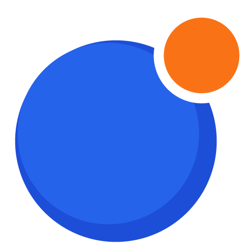

# Orbi

**Um agente pessoal que mora na borda da tela do Windows.**

Ele mostra o que os seus agentes do Claude Code estão fazendo, conversa com você 
por texto ou voz e faz pequenas tarefas no PC. Nada importante acontece sem você confirmar.

 

Windows 10 e 11 · instala em segundos · não pede administrador · se atualiza sozinho

 

[O que ele faz](#o-que-ele-faz) ·
[Instalar](#instalar) ·
[Primeiros passos](#primeiros-passos) ·
[Mascotes](#mascotes) ·
[Segurança](#ele-sempre-pede-antes) ·
[Problemas](#se-algo-der-errado)

 

## O que ele faz

<table>
<tr>
<td width="50%" valign="top">

**🤖 Mostra os seus agentes** 
Cada sessão do Claude Code vira um cartão com o estado (trabalhando, precisa de você, concluído ou erro) e os arquivos mudados. Um clique leva direto ao pedido que espera resposta.

</td>
<td width="50%" valign="top">

**💬 Conversa por texto ou voz** 
Pela aba Chat ou segurando `Ctrl+Alt+V` e falando. Quem pensa é o Claude Code da sua própria assinatura. Ouvir a sua voz acontece no próprio PC.

</td>
</tr>
<tr>
<td width="50%" valign="top">

**🗂️ Faz tarefas no PC** 
Abre apps, pastas e projetos no VS Code, toca música (até pelo nome no Spotify), cria lembretes, escreve no Obsidian e consulta o GitHub e o Gmail.

</td>
<td width="50%" valign="top">

**✅ Pede antes** 
Se a ação só abre ou toca algo, ela roda na hora. Se muda arquivos ou manda algo para fora do PC, aparece primeiro num cartão para você confirmar.

</td>
</tr>
<tr>
<td width="50%" valign="top">

**🧠 Lembra do que importa** 
Ele tem cadernos de memória, um pessoal e um por projeto. Quando aprende algo útil, sugere guardar, e você decide.

</td>
<td width="50%" valign="top">

**🎨 Fica do seu jeito** 
Cinco mascotes, na borda da tela ou numa ilha no topo, com fundos e paletas. Some sozinho em tela cheia e com a tela bloqueada.

</td>
</tr>
</table>

### Coisas que dá para pedir

> *"coloca Indecisão do Sotam"* · *"me lembra às 15h de ligar pro banco"* · *"abre o projeto do site no VS Code"* 
> *"o que chegou de não lido no Gmail?"* · *"tem review esperando por mim no GitHub?"* · *"anota isso no Obsidian"*

 

## Instalar

**Você precisa de:** Windows 10 ou 11. Para conversar e ver os seus agentes, também do [Claude Code](https://claude.com/product/claude-code) instalado, com a sua assinatura.

1. Clique em **Baixar para Windows**, lá em cima, e baixe o arquivo **`Orbi-Setup-<versão>.exe`**.
2. Abra o arquivo. A instalação leva poucos segundos, fica só no seu usuário e não pede administrador. No fim, o Orbi abre sozinho.

> [!TIP]
> Se aparecer **"O Windows protegeu o computador"**, clique em **Mais informações** e depois em **Executar assim mesmo**.
> O aviso aparece só porque o instalador ainda não tem certificado de assinatura.

 

## Primeiros passos

| | Passo | Para quê |
| :-: | --- | --- |
| **1** | Escolha o mascote em **Ajustes › Mascote** | Dá para trocar a qualquer hora |
| **2** | Conecte o **Claude Code** | Para conversar. Se precisar, o Orbi abre o login |
| **3** | Ligue os **ganchos** | Para ver os seus agentes na tela |
| **4** | Vincule contas na aba **Contas** *(opcional)* | Para usar Gmail, GitHub, Spotify e Obsidian |

Os ganchos mandam ao Orbi só o estado de cada agente. Nunca o texto dos pedidos, o código ou as respostas.

### Atalhos

| Tecla | O que faz |
| --- | --- |
| `Ctrl+Alt+O` | Abre o painel |
| `Ctrl+Alt+V` *(segurando)* | Fala com o mascote. Solte para enviar |
| `Ctrl+Alt+V` *(toque rápido)* | Abre o chat |

### Contas

Todas são opcionais e valem para todos os mascotes. As senhas e chaves ficam guardadas no cofre do próprio Windows.

| Conta | Para quê |
| --- | --- |
| **Google** | Ler os e-mails do Gmail, arquivar, marcar como lido e mandar para a lixeira |
| **GitHub** | Ver PRs, reviews e issues, avisar quando pedem review e clonar projetos |
| **Spotify** | Tocar música, artista ou álbum pelo nome (precisa de Premium) |
| **Obsidian** | Ler o cofre e escrever notas |

 

## Mascotes

<table>
<tr>
<td align="center" width="50%">
 
<b>Orbi e Faísca</b> 
Leve e caloroso, com bom humor
</td>
<td align="center" width="50%">
 
<b>Mar</b> 
Calmo, sem pressa, mas objetivo
</td>
</tr>
</table>

E mais três: **Ghastly**, um fantasma seco e misterioso; **Claude**, o Claw'd do Claude Code em pixel art; e **Lua**, calmo e noturno, que dorme quando nada acontece.

Todos têm as mesmas habilidades e as mesmas regras. Muda só o desenho, o jeito de falar e a voz.

 

## Ele sempre pede antes

- **Só você confirma.** Nem o mascote nem as contas ligadas conseguem aprovar nada sozinhos.
- **Pastas liberadas.** Fora das pastas que você liberar, mexer em arquivo pede confirmação. A lista começa vazia.
- **O que sai do PC pede confirmação.** E-mail, issue, comentário ou site fora da sua lista.
- **No Gmail, cuidado dobrado.** Ele não envia e-mail, não apaga de vez e nunca obedece a pedidos escritos dentro de um e-mail.
- **Nada de segredo guardado.** Senhas e chaves não entram na memória, nas notas nem nos registros.
- **Parado, não gasta.** Sem conversa, nenhuma chamada ao Claude.

 

## Atualizações

O Orbi instalado procura versões novas aqui e se atualiza sozinho, sem precisar de conta. Quando chega uma, ele espera você terminar o que está fazendo, instala em silêncio e abre de novo.

## Privacidade

Os dados ficam no seu computador, em `%APPDATA%\Orbi`. O que ele guarda, por quanto tempo e como apagar tudo está em **Configurações › Privacidade**, dentro do app.

 

## Se algo der errado

<b>O Windows bloqueou o instalador</b>

 

Na tela **"O Windows protegeu o computador"**, clique em **Mais informações** e depois em **Executar assim mesmo**. O aviso aparece porque o instalador ainda não tem certificado de assinatura.

<b>O Orbi sumiu da tela</b>

 

Ele se esconde de propósito em tela cheia e com a tela bloqueada, e não aparece na barra de tarefas nem no Alt+Tab. Saia da tela cheia ou aperte `Ctrl+Alt+O` para abrir o painel.

<b>Os meus agentes não aparecem</b>

 

Confira se os ganchos estão ligados (passo 3 dos [primeiros passos](#primeiros-passos)). Sem eles, o Orbi não fica sabendo do que o Claude Code está fazendo.

<b>Ele não toca a música pelo nome</b>

 

Tocar pelo nome usa o Spotify. Vincule a conta na aba **Contas**. Ela precisa ser Premium.

 

## Desinstalar

**Configurações do Windows › Apps › Orbi › Desinstalar.** Para apagar também os seus dados, apague a pasta `%APPDATA%\Orbi`.

---

Este repositório guarda só os instaladores do Orbi. Uso pessoal.

